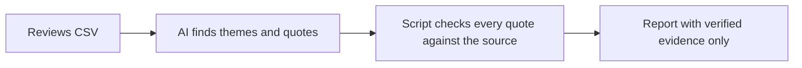

# Voice-of-Customer Miner

Turn a CSV of customer reviews into a marketing-ready report: pains, desires, objections and the exact phrases customers use. **Every item is backed by a verbatim quote, and the script checks each quote against your source data.** Anything the AI invented is dropped and listed at the end of the report.

## Why this exists

AI summaries of reviews often sound right but contain paraphrases, merged opinions or things nobody said. For copywriting and positioning that is a risk: you end up writing for a customer who does not exist. This tool keeps the useful part (themes, wording) and removes the part you cannot trust (unsupported claims).



## What you get

See [`sample_report.md`](sample_report.md) for a full example, built from a synthetic dataset.

- Pains, desires and objections, each with supporting quotes and the review number
- "Verified in X of N reviews" counts, calculated by the script, not by the AI
- Customer phrases worth reusing in headlines, hooks and emails
- A verification section: how many quotes matched, and which were dropped and why

## Quick start

### In your browser (easiest, free, nothing to install)

Open **https://lizavasylenko.github.io/voc-miner/** and click "Try with example reviews" to see the whole flow in 10 seconds. With your own data:

1. Paste your reviews, one per line, and click "Create prompt".
2. Copy the prompt into any AI chat (Claude, ChatGPT, anything).
3. Paste the AI's answer back and click "Check quotes".
4. Copy the report or download it as Markdown.

The page runs entirely in your browser. Your reviews are not uploaded anywhere by this page. Be careful what you paste into the AI chat itself: no names, emails or other personal data. The page works offline too: download `index.html` and open it.

The browser version also accepts a quote written with `...` if every part appears in the review, in order. The Python script below matches whole quotes only.

### With Python (optional)

Pick one way.

#### Option A: copy and paste (no API key, no cost beyond your AI chat)

1. Put your reviews in a CSV file with a column called `review`. Reviews that contain commas must be wrapped in double quotes.
2. Run `python voc_miner.py your_reviews.csv --print-prompt`
3. Paste the output into any AI chat. Save the JSON answer as `answer.json`.
4. Run `python voc_miner.py your_reviews.csv --analysis answer.json`
5. Open `report.md`.

#### Option B: API mode

1. `pip install -r requirements.txt`
2. Set your key: `export ANTHROPIC_API_KEY=your_key` (on Windows: `set ANTHROPIC_API_KEY=your_key`). Never commit the key to GitHub.
3. `python voc_miner.py your_reviews.csv`

The default model is set in the code and can be changed with the `VOC_MODEL` environment variable or `--model`. Check the current model names and prices in the provider documentation, because API use is billed.

#### Try the demo

```
python voc_miner.py sample_reviews_synthetic.csv --analysis sample_analysis.json
```

## How the verification works

For every quote the AI returns, the script checks that:
1. the cited review number exists,
2. the quote has at least three words,
3. the quote appears word for word (ignoring case, spacing and curly quotes) in that exact review.

A theme with no verified quote is removed. Run the tests with `python -m unittest`.

## What was tested, and what was not

- Tested: the verification logic, report building, CSV warnings and the copy-paste prompt (see `test_verify.py`). The browser page was tested in headless Chromium at phone width: the example gives 22 of 22 verified quotes, an invented quote is dropped, curly quotes, case, dash differences and `...` are handled, HTML in the AI answer is not executed, and the Ukrainian toggle and Markdown download work. It has not been tested in Safari or Firefox.
- The sample analysis (`sample_analysis.json`) was written by hand from the synthetic dataset to show the format. Its quotes are machine-verified, but it is not real model output.
- Not tested live: the API call itself, because no API key was available during development. If it fails on your setup, use Option A and open an issue.

## Limits

- Counts are lower bounds: only reviews with a verified quote are counted.
- The AI may miss a theme. Verification checks what is claimed, not what is missing.
- Only the first 200 reviews are used by default (`--max-reviews`).
- It reads text only. Sentiment, star ratings and review dates are not analysed.
- Small samples are not statistically meaningful. Treat results as qualitative input for messaging, not as market research.

## Privacy and data

Do not upload personal data. Remove names, emails and anything that identifies a person. Use reviews you are allowed to use: your own, data you have permission for, or datasets whose licence allows it. Respect the terms of the sites reviews come from, and do not scrape sites that forbid it.

## Measuring the time it saves

I am not claiming any savings. To measure your own:

| Task | Time by hand | Time with the tool |
|---|---|---|
| Analysing [N] reviews | [your measured time] | [your measured time] |

Monthly saving = (time by hand minus time with the tool) x runs per month x your hourly rate. Fill it in with your own numbers.

## Built with AI assistance

This project was built with help from an AI assistant and reviewed and tested by the author. [Add your own notes on what you changed.]

## Ideas for next versions

- Add a column for star rating and compare themes by rating
- Output the report as a slide-ready summary
- Compare two products side by side

---

Made by Yelyzaveta Vasylenko. B2B content and product marketer. [LinkedIn link]
